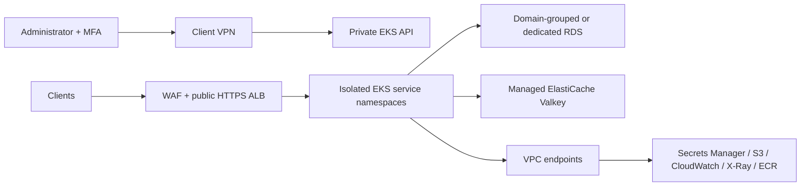

# Private EKS startup platform

Terraform infrastructure, a validated service DSL, Java 26 / Spring Boot examples, and validation CI without AWS credentials. AWS resources are **not deployed** by this repository's GitHub workflows.

The evaluator walkthrough is in the [root README](../README.md).

## Architecture

- Three pinned Availability Zones; isolated application/database subnets. No NAT or application Internet route. Public HTTPS ALB + WAF is the explicit public ingress exception.
- Private EKS API; human operators use SAML/MFA Client VPN and a federated IAM role. Kubernetes authorization remains mandatory after VPN connection.
- AWS-managed RDS PostgreSQL or MySQL: named domain groups share instances, never service databases/users/grants. Dedicated instances are also supported.
- AWS-managed ElastiCache for Valkey with TLS, IAM users and service key-prefix ACLs.
- Secrets Manager holds alternating runtime/migration credentials generated outside Terraform. RDS manages the master secret. A VPC Lambda rotates service credentials every 30 days, with failure alarms and a DLQ.
- Karpenter, HPA, per-service namespaces and default-deny network policies; CloudWatch logs/metrics and X-Ray traces. Native admission requires digest-pinned images in the environment account/region ECR, with exact AWS-managed add-on exceptions. See [workload security controls and rollout](workload-security.md).



## Repository

| Location | Responsibility |
|---|---|
| `bootstrap/` | Per-account state, audit trail and artifact registry; protect its initial local state until authorized migration |
| `environments/{dev,staging,prod}/` | Independent AWS infrastructure roots |
| `kubernetes/{dev,staging,prod}/` | Independent controller/configuration roots, reachable through VPN |
| `modules/networking/`, `modules/platform/` | First-party Terraform modules; no third-party Terraform modules |
| `services/`, `schemas/`, `config/` | Service contracts, schema and environment database groups |
| `charts/` | Application and platform Helm charts |
| `examples/apps/` | Shared Spring Boot demo image configured as payments-service or auth-service |
| `components/credential-manager/` | Database provisioning and alternating-user rotation |
| `scripts/`, `tests/` | Contract compiler, policy checks, operator tooling and tests |

## Validate without AWS credentials

Prerequisites: Terraform 1.14+, Docker, Helm 3+, Python 3.12+, JDK 26. Maven Wrapper is included. Build images, runtime images, Maven target and CI use Java 26; see the [migration, support risk and rollback guide](java26.md). Temurin 26 reached end of community support in September 2026, so production acceptance requires a supported runtime strategy. `scripts/install_tools.py` installs checksum-pinned TFLint, Trivy, Gitleaks, kind and Infracost into `.artifacts/bin` (macOS ARM64 / Linux AMD64).

```bash
python3 -m venv .venv
.venv/bin/pip install -r requirements-dev.txt
python3 scripts/install_tools.py
export PATH="$PWD/.artifacts/bin:$PATH"
scripts/prepare-assets.sh
scripts/validate.sh
examples/apps/mvnw -B -f examples/apps/pom.xml verify
```

`prepare-assets.sh` downloads pinned upstream Helm charts, the RDS CA bundle and local Calico manifest, then verifies their reviewed checksums. A checksum change fails closed. Review upstream provenance before updating `config/artifacts.lock.json`.

Run scanners as in `.github/workflows/validate.yaml`. Checkov exceptions are resource-specific and explained in [security exceptions](security-exceptions.md); Trivy exceptions expire. No global skip of encryption, public exposure or IAM checks is configured.

## Estimate costs

With an Infracost API key configured locally, run `.venv/bin/python scripts/estimate_costs.py`.
The command estimates dev, staging and prod from the validated service contracts and example sizing, without AWS credentials or Terraform plans.
Reports are written to ignored `build/infracost/`. The separate Infracost Actions workflow uses the `INFRACOST_API_KEY` repository secret, publishes a job summary and retains report artifacts for seven days.
See [cost configuration and estimate limitations](cost.md) before using the results for a budget.

## Local development

See [local setup](local.md). MiniStack is the AWS emulator; there is no LocalStack dependency or license-token requirement. Local DB credentials are disposable. Real AWS networking, IAM enforcement and failover require separate AWS acceptance testing.

## Configure and deploy

See [deployment runbook](deployment.md), [service DSL](service-dsl.md), and [cost model](cost.md). Example account IDs, certificates, image references and add-on versions are intentionally non-deployable placeholders. No credentials, state, plan files or secret values should be committed.

Production and non-production accounts must differ. Every environment has its own VPC, cluster, database groups and state; cache is provisioned only when requested by a service. Region defaults to `us-east-1`; portability is subject to the selected region's capabilities, checked by the read-only preflight.

These applications are integration examples, not a production payment processor or identity provider. Their demo write endpoints are unauthenticated; replace them with business applications and authentication before exposing real data.

See [executed validation and outstanding AWS acceptance checks](validation.md) for the implementation evidence, scanner results and deployment limitations.
